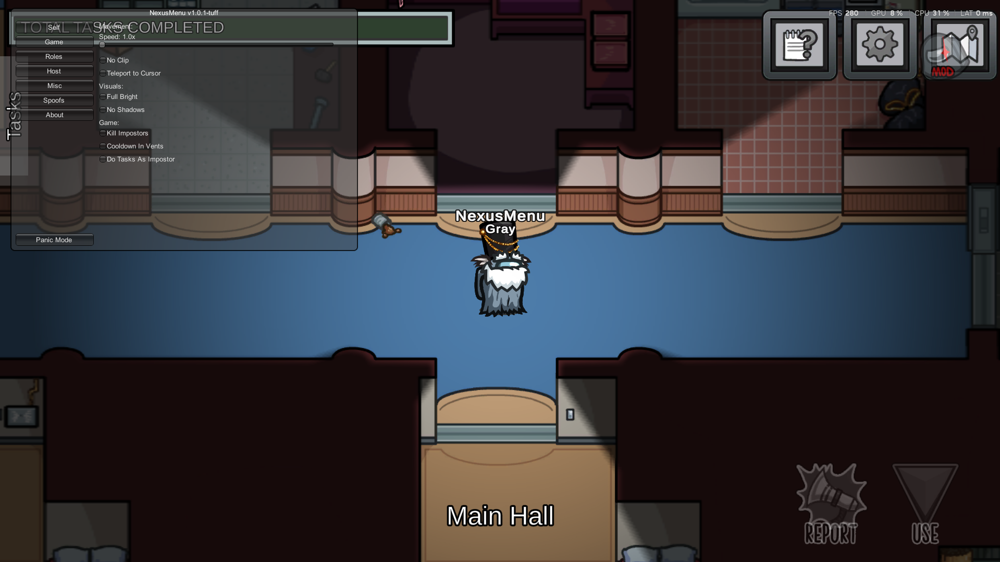
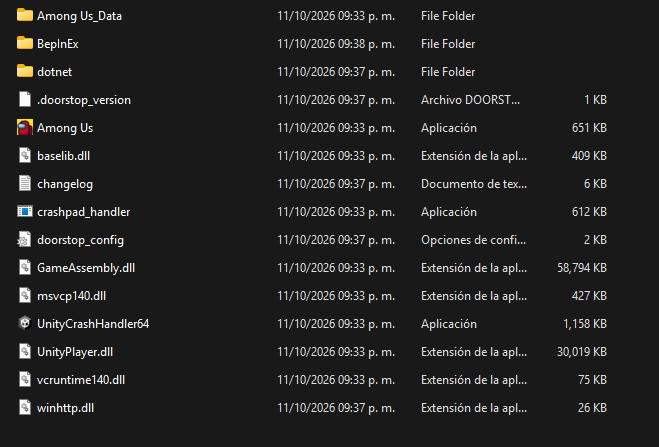

<h1 align="center">NexusMenu</h1>

  

NexusMenu is a Among Us mod that aims to give the best experience to the user with new features upcoming.

We have a [discord](https://discord.gg/gaQvGxK5F8) if you need help or have ideas!

# BepInEx is needed for this Mod to work!

## How to install BepInEx:
1. Download the .DLL from the releases
2. Download [BepInEx](https://builds.bepinex.dev/projects/bepinex_be) (download the x64 IL2CPP version)
3. Extract the BepInEx zip and paste it on your Among Us folder, it should look like this:

4. Copy and paste (or cut) the .DLL file and put it on BepInEx > Plugins folder

and done! You got the mod ready!

# Features
- Noclip
- Speedhack
- Teleport
- [No Cooldown in vents](https://streamable.com/11qc3l)

and more!
